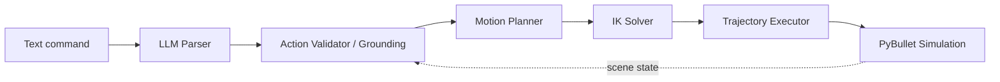

# Talk-to-the-Arm: Vision-Language-Action Demo

This project implements a small, from-scratch version of the vision-language-action (VLA) pattern behind models like RT-2, OpenVLA, $\pi$0, and GR00T.

You can type or speak natural language commands like *"pick up the red block and place it on the shelf"*, and a Language Model parses it into an actionable plan that is verified, expanded into a trajectory, and executed live on a simulated 4-DOF robotic arm using Inverse Kinematics.

## Architecture



## Quick Start

1. Install dependencies:
   ```bash
   pip install -r requirements.txt
   ```
2. Run the demo:
   ```bash
   python main.py "pick up the red block and place it on the shelf"
   ```

## Background: CAD to Code

The base of this project (`cad/` directory) originated from a SolidWorks mechanical design of a 4-DOF aluminum arm (revolute-revolute-revolute-revolute, up to 1 kg payload, 1 m workspace). This software stack was built to simulate that physical design and turn it into a smart agent using modern Language-Action capabilities.

## Technical Details

- **Simulation:** PyBullet for fast, lightweight kinematic simulation.
- **IK:** Position-target wrapper around PyBullet's solver.
- **LLM Integration:** JSON schema-constrained prompting, with a local-first design (e.g. Ollama `qwen2.5`) or API fallback.
- **Validation:** Emitted targets are verified against a hardcoded tabletop scene registry to prevent hallucinatory reaches.
